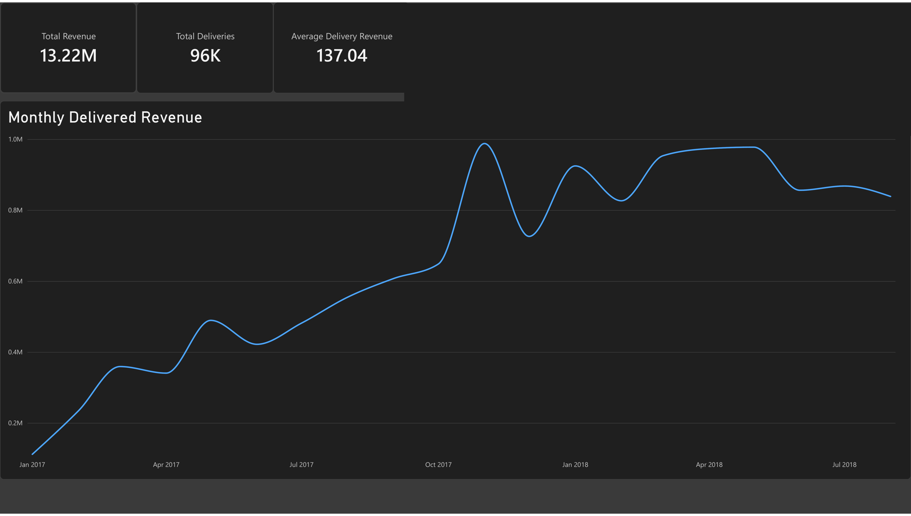
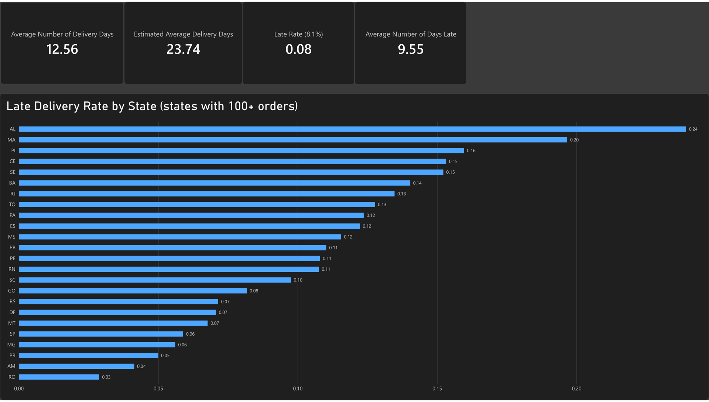
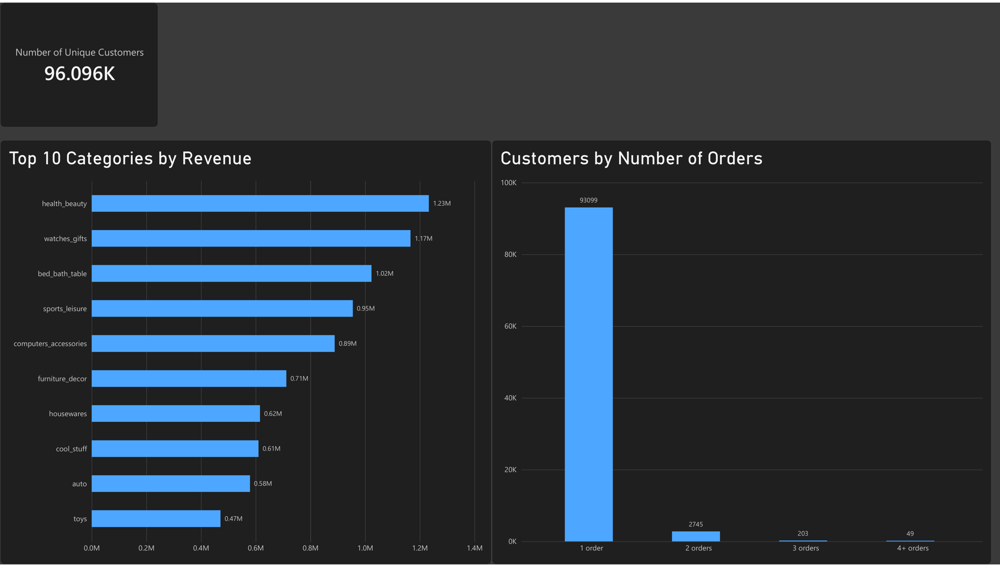

# E-Commerce Sales & Customer Analytics Using SQL and Power BI

## Project Overview

This project uses PostgreSQL to analyse the Brazilian E-Commerce Public Dataset by Olist, an anonymised dataset containing approximately 100,000 orders from Brazilian online retailers. The results are summarised in a three-page Power BI dashboard.

The project aims to investigate business performance through SQL-based data exploration, validation and KPI analysis.

The analysis focuses on understanding sales performance, customer purchasing behaviour, product performance and delivery efficiency.

**Project status:** SQL analysis scripts for all four areas and a first Power BI dashboard are complete. Further investigation of late deliveries is planned.

## Business Objectives

The project investigates four key areas:

1. **Sales Performance:** How much revenue does the business generate, and how does sales performance change over time?
2. **Customer Analytics:** What are the purchasing patterns of customers, and how frequently do they return?
3. **Product Analytics:** Which products and categories contribute the most to sales?
4. **Delivery Performance:** How efficiently are orders fulfilled, and how frequently are deliveries delayed?

## Tools and Technologies

- **PostgreSQL:** Database management and SQL analysis
- **Visual Studio Code:** Writing and executing SQL queries
- **Power BI (Service):** Dashboard built in the browser
- **Git and GitHub:** Version control and project documentation
- **SQL:** Joins, aggregations, window functions, date operations and data validation

## Dataset

**Source:** [Brazilian E-Commerce Public Dataset by Olist — Kaggle](https://www.kaggle.com/datasets/olistbr/brazilian-ecommerce)

Five CSV datasets have been imported into PostgreSQL.

| Table | Records | Description |
|---|---:|---|
| customers | 99,441 | Customer identifiers and geographic information |
| orders | 99,441 | Order statuses and timestamps |
| products | 32,951 | Product information and attributes |
| order_items | 112,650 | Products purchased, prices and freight |
| order_payments | 103,886 | Payment methods, instalments and values |

The datasets are connected through primary and foreign keys, allowing analysis across multiple relational tables.

Raw CSV files are excluded from GitHub using `.gitignore`.

## Project Structure

```text
ecommerce_sql_analysis/
├── data/
│   └── README.md
├── sql/
│   ├── 01_database_setup.sql
│   ├── 02_data_exploration.sql
│   ├── 03_sales_analysis.sql
│   ├── 04_customer_analysis.sql
│   ├── 05_product_analysis.sql
│   └── 06_delivery_analysis.sql
├── figures/
│   ├── sales_overview.png
│   ├── delivery_performance.png
│   └── customers_products.png
├── insights/
├── .gitignore
└── README.md
```

## Power BI Dashboard

A three-page dashboard summarising the analysis. Revenue figures count delivered orders only and use item prices, excluding freight. The monthly trend chart is limited to January 2017 – August 2018, because 2016 and the final months of the dataset contain very few orders.

### 1. Sales overview



### 2. Delivery performance



The state chart is limited to states with at least 100 orders, so that small samples do not dominate the ranking.

### 3. Customers and products



**Note on how the dashboard was built:** the dashboard reads from a summary workbook (one row per order, plus category and customer-order tables) that applies the same logic as the SQL queries in this repository. It is not a live connection to the PostgreSQL database. The headline figures match the SQL results.

## Analysis and Key Findings

### 1. Order Status Analysis

**Business Question:** What proportion of orders were successfully delivered?

SQL techniques:
- `COUNT(*)`
- `GROUP BY`
- `ORDER BY`
- Window functions using `OVER()`

**Finding:** 97.02% of recorded orders have a delivered status (96,478 orders).

This indicates that most orders in the dataset were recorded as delivered. However, the proportion of delivered orders alone does not establish whether deliveries were timely.

### 2. Data Quality Assessment

**Business Question:** Are there missing values in the orders table?

Missing values identified among 99,441 orders:

| Column | Missing values |
|---|---:|
| order_approved_at | 160 |
| order_delivered_carrier_date | 1,783 |
| order_delivered_customer_date | 2,965 |

No missing values were identified in the order ID, customer ID, order status, purchase timestamp or estimated delivery date columns.

Further analysis by order status identified several inconsistencies:

- 14 delivered orders had no approval timestamp.
- 2 delivered orders had no carrier delivery timestamp.
- 8 delivered orders had no customer delivery timestamp.
- 6 cancelled orders contained a customer delivery timestamp.

Missing delivery timestamps can be expected for orders that have not yet been delivered. However, inconsistencies in completed orders warrant additional investigation.

The 8 delivered orders without a customer delivery date were excluded from delivery duration calculations.

### 3. Sales Performance

**Business Question:** How much revenue does the business generate, and how does it change over time?

| KPI | Result |
|---|---:|
| Delivered orders | 96,478 |
| Product revenue (delivered orders, excluding freight) | 13,221,498.11 |
| Average order value | 137.04 |

**Key insights:**

Monthly revenue grew through 2017, peaking in November 2017 at about 988K, and then levelled off at roughly 0.85M to 1M a month in 2018 (for example, 978K in May 2018).

The dataset does not explain the November 2017 peak, so no cause is claimed here.

### 4. Customer Analytics

**Business Question:** What are the purchasing patterns of customers, and how frequently do they return?

| KPI | Result |
|---|---:|
| Unique customers | 96,096 |
| Customers with one order | 93,099 |
| Customers with two orders | 2,745 |
| Customers with three orders | 203 |
| Customers with four or more orders | 49 |
| Repeat customer rate | 3.12% |

**Key insight:** Roughly 97% of customers placed only one order. Growth in this dataset therefore comes mainly from new customers, not from repeat purchases.

### 5. Product Analytics

**Business Question:** Which products and categories contribute the most to sales?

The three highest-revenue categories among delivered items are `health_beauty` (about 1.23M), `watches_gifts` (about 1.17M) and `bed_bath_table` (about 1.02M). The top ten categories are shown in the dashboard.

### 6. Delivery Performance

**Business Question:** How long do deliveries take, and how often are orders late?

Based on 96,470 delivered orders with recorded customer delivery dates:

| KPI | Result |
|---|---:|
| Average delivery time | 12.6 days |
| Average estimated delivery time | 23.7 days |
| Orders delivered after estimate | 7,826 |
| Late delivery rate | 8.11% |
| Average delay among late orders | 9.6 days |
| Maximum observed delay | 189 days |

**Key insights:**

Most delivered orders arrived within their estimated delivery window.

Although actual delivery times were shorter than estimated delivery times on average, 8.11% of delivered orders with usable timestamps missed their estimated arrival date.

Late deliveries were delayed by an average of 9.6 days, suggesting that delays may represent a meaningful customer experience issue rather than minor scheduling differences.

The maximum delay of 189 days represents an extreme observation that warrants further investigation.

**Late rate by state (states with at least 100 orders):** late deliveries are concentrated in a few northern and north-eastern states. Alagoas (AL) has the highest late rate at 23.9%, followed by Maranhão (MA) at 19.7% and Piauí (PI) at 16.0%. By comparison, São Paulo (SP) has a late rate of 5.9% and Minas Gerais (MG) 5.6%.

**Potential business implication:** Delivery reliability could be improved by investigating the products, sellers or geographic areas associated with late deliveries. The state-level pattern shows where delays occur but does not explain why, so further analysis is needed before identifying the underlying causes.

## Possible Extensions

- Connect Power BI directly to the PostgreSQL database so the dashboard is built from the SQL queries themselves.
- Investigate the extreme delivery delays and whether they relate to specific sellers or product categories.
- Analyse revenue per customer and purchase frequency in more detail.

## Reproducing the Analysis

1. Install PostgreSQL.
2. Download the Olist dataset from the Kaggle link above.
3. Create a PostgreSQL database named `ecommerce_analysis`.
4. Execute `sql/01_database_setup.sql` to create the relational tables.
5. Place the required CSV files in the local `data/` folder.
6. Import the CSV datasets into their corresponding tables, following the instructions in `data/README.md`.
7. Run the SQL analysis scripts using PostgreSQL.

## Limitations

- The dataset contains historical transactions from 2016–2018.
- Order status reflects the recorded state of each transaction, not necessarily its final outcome.
- Some delivery timestamps are missing or inconsistent.
- The current analysis uses only five of the available Olist tables.
- The dashboard is built from a summary workbook that replicates the SQL logic, not from a live database connection.
- Observed associations do not necessarily establish causal relationships.

## Project Purpose

This project forms part of my Data Analyst portfolio and demonstrates the application of SQL to real-world business questions, including relational data management, data quality assessment, KPI calculation, evidence-based business reporting and dashboard design.